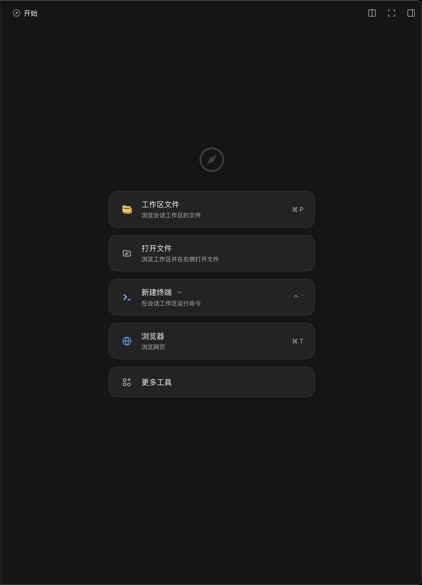
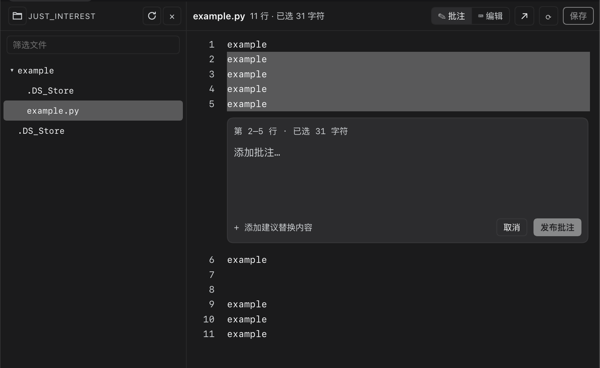
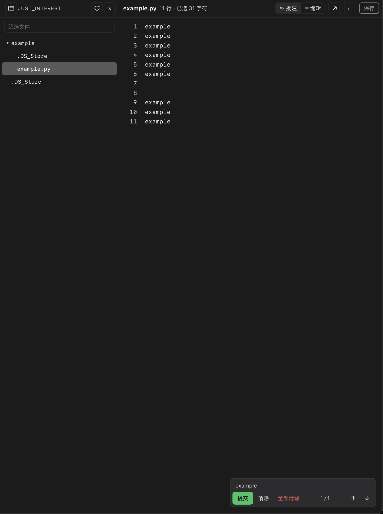

# 文件批注器 · File Annotator

**An annotatable file editor for the DeepSeek Harness (DSH) right sidebar.**

在 DSH 右侧栏中打开工作区文件，选中文本写批注，跨文件跳转批注，并把结构化修改要求加入对话草稿。

- 选中文本即可写批注，不用离开文件
- 批注在所有文件之间统一计数、统一导航
- 提交只加入对话输入框，不会自动发送
- Markdown 实时预览
- 原生 DSH 外观；无构建步骤、无运行时 npm 依赖

## 功能

### 文件编辑

- 以 `extension` 优先级接管常见文本/代码文件，在右侧栏直接打开。
- 支持编辑与保存；`⌘/Ctrl+S` 保存，带文件版本校验，避免覆盖外部修改。
- 大文件超过 20 万字符时退化为纯文本模式，并禁用申请重定位等重操作。

### 行内批注

- 默认“批注”模式：选中文本后，在选中行下方出现批注块。
- 批注块内 **Enter 发布，Shift+Enter 换行**；中文输入法组合输入期间不会误发布。
- “编辑”模式恢复正常选中/复制/编辑。
- 批注引用创建时的原文和行号；原文被改写导致 quote 不再匹配时标记为 stale，并提示位置可能已失效。

### 跨文件批注导航

- 当前会话只要有批注，右下角就显示统一计数 `1/N`。
- `↑/↓` 跨文件切换，自动打开目标文件并定位到批注范围。
- 在工作区模式下切换右侧当前文件，文件树保持不动；在独立编辑器 tab 中则替换当前 tab，不堆积新 tab。
- `提交` 把当前文件的批注加入对话草稿，成功后自动清除已提交的当前文件批注；`清除` 清当前文件；`全部清除` 清当前会话全部批注，并带二次确认。

### Markdown 预览

- 打开 `.md` / `.markdown` / `.mdx` 时，工具栏出现「预览」按钮。
- 用当前编辑中的 draft 渲染标题、段落、列表、引用、表格、代码块、链接等。
- 按钮文字始终是「预览」，通过亮/不亮表示当前是否处于预览状态。
- 预览为只读；再次点击关闭预览回到源码。

### 文件树

- 「打开文件」工作区：左侧文件树 + 右侧编辑器。
- 懒加载目录、目录变更自动刷新、筛选、刷新、拖宽、当前文件高亮。
- 支持键盘导航、双击打开、展开/滚动位置持久化。
- 可隐藏文件树，保留左侧 30px 轨道重新展开。

### 非文本文件

图片、PDF、Office 等非文本文件不在批注编辑器内渲染；从文件树点击时交给宿主原生预览打开。PDF 使用 DSH 宿主的 PDF 查看器，不是插件内嵌的 PDF 渲染器。

### 其它

- 原有只读文本预览可通过头部 `✎ 批注此文件` 转换为批注编辑器。
- 工具栏 `↗` 可用宿主原生预览打开同一文件。
- 右侧栏终端使用 DSH 原生 `terminal` tab；插件不提供伪终端。

## 安装

### 从 GitHub 安装

```sh
dsh plugin --profile <profile> add github:Arvin-work/dsh-plugin-file-annotate
```

如果使用 DSH Desktop，建议在 **Settings → Plugins → Add plugin** 中粘贴 GitHub 仓库地址，由桌面端管理当前 Profile。

安装后按提示刷新页面；如果宿主支持热加载，通常刷新即可看到「打开文件」入口。

### 从 Release tarball 安装

如果仓库的 GitHub Release 提供了 tarball：

```sh
dsh plugin --profile <profile> add <Release tarball 的 https 地址>
```

### 插件市场

被 DSH Market 收录后，可以在市场搜索 **File Annotator** 或 **文件批注器** 后一键安装。

## 使用流程

> 说明：截图中的示例项目 `just_interester`（界面标题显示为 `JUST_INTEREST`）、`example.py` 文件以及 `example` 批注均为演示数据，仅用于说明操作流程，不代表真实项目、真实文件或真实用户数据。

1. 打开右侧栏的「打开文件」。

   

2. 从左侧文件树选择一个文本/代码文件。
3. 在“批注”模式下选中一段文本。
4. 在出现的批注块里写下修改要求，按 Enter 发布。

   

5. 用右下角浮动条的 `↑/↓` 跨文件浏览批注。
6. 需要让智能体处理时，点 `提交`：批注会加入当前对话输入框，确认后再发送；提交成功后当前文件批注会自动清除，没有剩余批注时浮动条消失。

   

7. 需要直接修改文件时，切到“编辑”模式，改完保存。

## 隐私与数据

- 批注保存在当前浏览器的 `localStorage`，按会话和文件区分。
- 插件没有遥测，不会把批注、文件内容或个人信息发送到第三方服务。
- 文件读取/写回通过 DSH 宿主的 workspace/file API 完成，遵守宿主的文件策略和沙箱。
- `提交` 只调用宿主的 composer actions（必要时回退到 bridge）把文本追加到对话输入框，不会直接提交给模型。

## 已知限制

- PDF、图片、Office 等非文本文件不能在批注编辑器中编辑或批注；它们交给宿主原生预览。
- 插件不内嵌终端；终端使用 DSH 原生右侧栏 terminal tab。
- 大文件（>200k 字符）使用纯文本高亮，且不执行批注重定位；直接保存也受 20 万字符限制。
- 批注 quote 被改写后会显示 stale，无法自动定位到正确位置。
- 关闭编辑器 tab 不会弹未保存确认；需要先保存。
- 依赖当前 DSH 的 Client 插件/侧栏 API；DSH 升级后如有 API 变化可能需要适配。

## 开发

插件没有构建步骤，也没有运行时 npm 依赖：

- `index.js` — Host 半，注册保存命令。
- `client.js` — Client 半，注册侧栏 tab、编辑器、文件树、批注导航、Markdown 预览。
- `cordis.patch.yml` — bundle patch，插入 `file-annotate` 行。
- `locale/{zh,en}.json` — 插件管理器显示名称与描述。
- `icon.svg` — 插件图标。

开发时可以用本地目录 link 安装：

```sh
dsh plugin --profile <profile> add /absolute/path/to/dsh-plugin-file-annotate
```

## License

MIT. See the LICENSE file in the repository.
